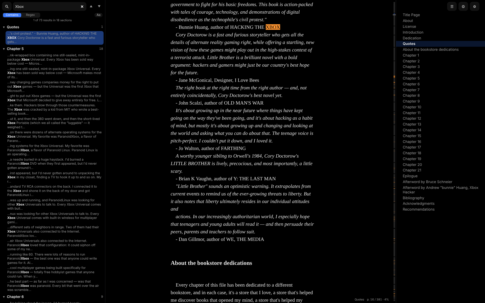
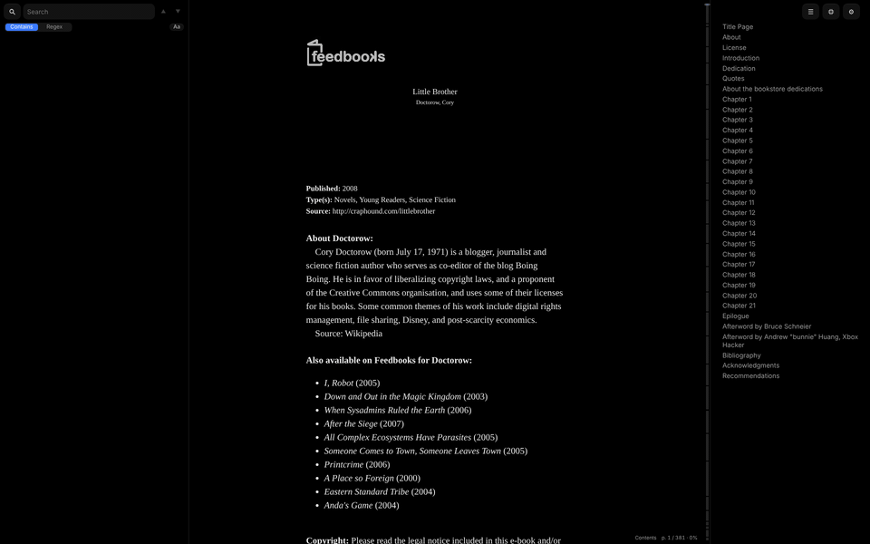

<h1> Scrolle</h1>

<p>
  
  
</p>

## Mission statement

I want to to scroll through an entire book from top to bottom without being interrupted by silly concepts like pages or chapters.

## Features

- **Scroll**: You can scroll through the entire book
- **Search**: You can search through the entire book
- **Chapters**: You can see all the chapters in the entire book
- **Mulitple Books**: You can open more than one EPUB and scroll through multiple entire books

## Run it

```bash
npm install
npm run dev        # http://localhost:5173
npm test           # unit tests
npm run tauri dev  # native app dev
```

## Build it

`npm run <target>`:

| Target | Output |
| --- | --- |
| `build` | web app |
| `build:single` | standalone HTML file |
| `build:extension`, `build:zip`, `build:crx` | Chrome extension that can open `.epub` links and downloads in the reader |
| `build:exe` | Windows app (Tauri) |
| `build:apk` | Android app (Capacitor) |
| `build:all` | all of the above |

## AI Disclosure

I used AI.

## License

The screenshots in `docs/screenshots/` contain excerpts from *Little Brother* by Cory Doctorow, licensed [CC BY-NC-SA 3.0](https://creativecommons.org/licenses/by-nc-sa/3.0/). They are shared under that licence, and not under any license covering the code in this repository.
